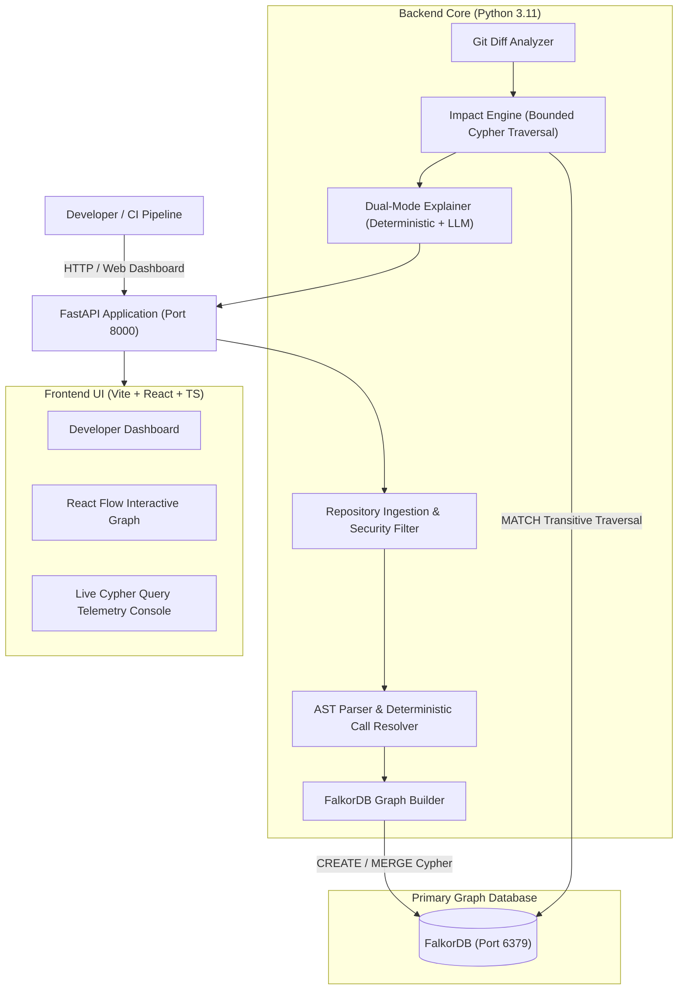

# CodeImpact AI Architecture

CodeImpact AI is an agentic developer tool built for **Track 1: Agents That Act on Connected Data**. It performs deterministic codebase change impact analysis using **FalkorDB** as its primary graph engine, combined with Python AST parsing and an optional explanation engine.

---

## 1. System Architecture Diagram

---

## 2. Component Breakdown

### A. Repository Ingestion & Security Filter (`app/core/ingestion.py`)
- Accepts validated GitHub repository URLs or ZIP archive uploads.
- **Zip Slip Prevention:** Rejects relative traversal (`../`) and absolute target paths.
- **Resource Constraints:** Enforces 500 file limit and 25MB archive limit.
- **Safe Scanning:** Excludes `.git`, virtual environments, build artifacts, secrets (`.env`), and binaries.
- **Unsupported Languages:** Detects non-Python files (e.g. JS, TS, Go, Rust) and reports them cleanly instead of pretending they were analyzed.
- **Code Execution Guarantee:** Ingested source code is parsed via AST only and never executed.

### B. Python AST Parser & Resolver (`app/core/parser.py`)
- Uses Python's native `ast` module to construct Abstract Syntax Trees.
- Extracts module-level imports (including aliases and relative imports).
- Extracts symbols (functions, classes, methods) with line spans, parameters, and docstrings.
- Identifies automated test files and test functions.
- Resolves cross-file function calls using a 4-tier deterministic resolution strategy:
  1. Local functions in the same file.
  2. Directly imported symbols (`from x import y`).
  3. Module-scoped calls (`module.function()`).
  4. Global unambiguous matches across the repository.
- If a call cannot be resolved statically, it is explicitly flagged as `unresolved`—never hallucinated.

### C. FalkorDB Graph Builder (`app/core/graph_builder.py`)
- Connects to FalkorDB via the official `falkordb` Python client.
- Uses dedicated isolated graphs per repository (e.g. `repo_sample_auth_service`).
- Idempotent indexing: resets existing graph data on re-index to prevent duplicate nodes.
- Uses parameterized Cypher queries for all insertions.

### D. Graph-Powered Impact Engine (`app/core/impact_engine.py`)
- Executes bounded multi-hop OpenCypher queries (`*1..5`) to trace all upstream callers.
- Computes shortest call paths connecting callers to target symbols.
- Handles cyclic dependencies cleanly using path length constraints and set deduplication.
- Evaluates blast radius risk (`CRITICAL`, `MODERATE`, `LOW`) based on caller count, test reachability, and graph depth.
- Projects subgraphs into structured nodes and edges for React Flow rendering.

### E. Dual-Mode Explainer (`app/core/llm_explainer.py`)
- **Deterministic Engine:** Generates structured markdown summaries directly from retrieved graph data without requiring an API key.
- **LLM-Augmented Engine (Optional):** If `GEMINI_API_KEY` is configured, answers arbitrary natural language questions with strict adherence to retrieved FalkorDB graph facts.
- **Integrity Rule:** Explicitly distinguishes verified dependency facts from suggested tests, and clarifies that recommended tests have NOT yet been run.

### F. Frontend Dashboard (`frontend/`)
- Built with React, Vite, TypeScript, and Tailwind CSS.
- **Interactive Graph:** Visualizes callers and tests with custom styled React Flow nodes.
- **Live Cypher Telemetry Console:** Inspects the exact queries, parameters, and latency executed against FalkorDB.
- **Git Diff Blast Radius:** Evaluates changed code lines and computes impacted components.
